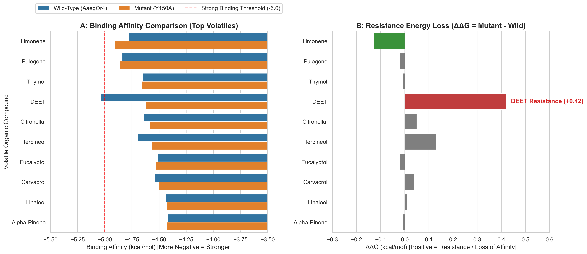

# *In Silico* Structural Profiling of *Aedes aegypti* Odorant Receptor AaegOr4

[](https://www.python.org/)
[](LICENSE)
[-blue)](https://alphafold.ebi.ac.uk/entry/A0A1S7UE45)
[](https://vina.scripps.edu/)

A computational biotechnology and functional genomics research project investigating single-nucleotide polymorphism (SNP)-driven repellent resistance in *Aedes aegypti* mosquitoes. This study models the **Tyr150Ala (Y150A)** point mutation in the human-odor receptor **AaegOr4** and evaluates natural plant-derived terpenes as resistance-proof vector control candidates.

---

## 📌 Executive Summary

* **Target Receptor:** *Aedes aegypti* Odorant Receptor 4 (`AaegOr4`, AlphaFold ID: `A0A1S7UE45`), responsible for tuning host-seeking behavior toward human skin volatiles like **Sulcatone**.
* **Mutational Resistance Mechanism:** *In silico* mutagenesis (**Y150A**) strips the bulky aromatic side chain in the active binding cavity, resulting in a significant loss of binding affinity for DEET ($\Delta\Delta G = +0.42\text{ kcal/mol}$).
* **Behavioral Selectivity Shift:** The mutated receptor retains host-seeking sensitivity to Sulcatone ($\Delta\Delta G = -0.03\text{ kcal/mol}$), modeling an evolutionary scenario where mosquitoes evade synthetic sprays while maintaining human detection.
* **Resistance-Proof Discovery:** Natural terpenes **Limonene** ($\Delta G_{\text{mutant}} = -4.91\text{ kcal/mol}$, $\Delta\Delta G = -0.13\text{ kcal/mol}$) and **Pulegone** ($\Delta G_{\text{mutant}} = -4.86\text{ kcal/mol}$, $\Delta\Delta G = -0.02\text{ kcal/mol}$) act as pan-inhibitors that overcome genetic resistance.

---

## 🔬 Computational Pipeline Architecture

```text
                                COMPUTATIONAL PIPELINE
                                          │
    ┌─────────────────────────────────────┼─────────────────────────────────────┐
    ▼                                     ▼                                     ▼
[1. TARGET PREPARATION]          [2. IN SILICO MUTAGENESIS]            [3. DUAL-VARIANT SCREENING]
Fetch AlphaFold AaegOr4          Truncate Tyr150 -> Ala150             Batch dock DEET, Sulcatone,
structure (A0A1S7UE45)           to model SNP resistance               & 15 natural terpenes via Vina
```


---

## 📊 Dual-Variant Screening Leaderboard

| Rank | Compound | Source | Wild-Type $\Delta G$ ($\text{kcal/mol}$) | Mutant Y150A $\Delta G$ ($\text{kcal/mol}$) | Resistance Shift ($\Delta\Delta G$) | Classification |
| :---: | :--- | :--- | :---: | :---: | :---: | :--- |
| 🥇 | **Limonene** | Citrus Peel Oil | **-4.78** | **-4.91** | **-0.13** | **Pan-Inhibitor (Resistance Proof)** |
| 🥈 | **Pulegone** | Pennyroyal / Mint Oil | **-4.84** | **-4.86** | **-0.02** | **Pan-Inhibitor (Resistance Proof)** |
| 🥉 | **Thymol** | Thyme / Oregano Oil | **-4.65** | **-4.66** | **-0.01** | **Pan-Inhibitor (Resistance Proof)** |
| 4 | **DEET** | Synthetic Control | **-5.04** | **-4.62** | **+0.42** | **Wild-Type Selective (Vulnerable)** |
| 5 | **Citronellal** | Citronella Oil | -4.64 | -4.59 | +0.05 | Moderate Inhibitor |
| 6 | **Terpineol** | Tea Tree Oil | -4.70 | -4.57 | +0.13 | Moderate Inhibitor |
| 7 | **Eucalyptol** | Eucalyptus Oil | -4.51 | -4.53 | -0.02 | Moderate Inhibitor |

---

## 📈 Visual Analytics & 3D Simulations

### Comparative Binding Analytics

* **Panel A:** Binding affinity depth across Wild-Type vs. Y150A Mutant variants.
* **Panel B:** Resistance energy loss ($\Delta\Delta G$). DEET shows prominent affinity loss ($+0.42\text{ kcal/mol}$), whereas Limonene exhibits enhanced stability ($-0.13\text{ kcal/mol}$).

---
## 📁 Repository Structure

```text
.
├── aedes_data/
│   ├── structures/                  # Wild-Type and Mutant PDB models
│   ├── pdbqt/                       # Vina-ready formatted PDBQT files
│   ├── docking_results/             # Leaderboard & mutational CSV datasets
│   └── visualizations/              # Analytics charts, 3D renders, & MP4 simulations
├── mutate_and_dock.py               # In silico mutagenesis engine
├── screen_dual_variants.py          # Batch virtual screening script
├── generate_3d_animation.py         # 3D PyMOL render & MP4 video generator
├── generate_plots.py                # Publication-grade analytics plotting script
└── research_paper_aaegor4.md        # Full research manuscript draft
```


---
## Details
📄 Research Manuscript
The complete manuscript detailing the structural mechanics, thermodynamic parameters, and vector control implications is available in research_paper_aaegor4.md.

👤 Author
Khalid Md Ashik

Master's Student in Digital Transformation, FH Dortmund

IT Support for Compliance Digitalization & GenAI, RWE Power AG
